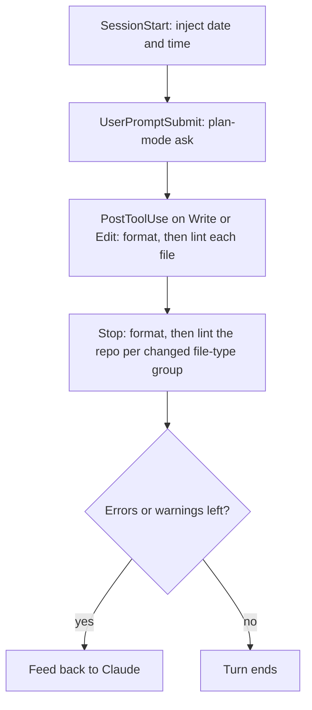

# CDK — Claude Dev Kit

Claude Code plugin providing a development kit — skills, custom agents, and hooks — for any framework or language.

Adds guided Git and GitLab workflows (signed atomic commits, rebases, merge requests, reviews) plus skill, README, and CLAUDE.md authoring with scored rubrics, so Claude follows the same conventions in every repository.

> **Status:** pre-1.0 (v0.4.1). This repo changes a lot: skills, agents, and hooks may be renamed or removed in any minor release, so pin a version. Breaking changes are listed in [CHANGELOG.md](CHANGELOG.md).

- [Compatibility](#compatibility)
- [Install](#install)
- [Components](#components)
- [Versioning and changelog](#versioning-and-changelog)
- [Development](#development)
- [Contributing](#contributing)
- [Support](#support)
- [License](#license)

## Compatibility

- [Claude Code](https://code.claude.com/docs) CLI (`claude`).
- Git; commit and rebase skills sign commits when signing is configured. `/cdk:setup-git` SSH signing needs Git 2.34+; OpenPGP needs GnuPG.
- [`glab`](https://gitlab.com/gitlab-org/cli) CLI, authenticated, for the GitLab merge request skills.
- [`gh`](https://cli.github.com/) CLI, authenticated, for the pull request skills, `/cdk:create-github-release`, and `/cdk:publish-github-release`.
- GitHub and GitLab MCP servers optional: skills call their tools first and fall back to `gh`/`glab` when a server is not connected or errors.
- [`uv`](https://docs.astral.sh/uv/) for `/cdk:setup-spec-kit` when `specify` is not installed.
- [`uv`](https://docs.astral.sh/uv/) or `pipx` (Python 3.10+) for `/cdk:setup-graphify` when `graphify` is not installed.
- Node.js with npm, pnpm, yarn, or bun for `/cdk:setup-husky` and the npm tools of `/cdk:setup-format-lint`.
- The project's package manager for `/cdk:upgrade-dependencies`.
- Docker for `/cdk:build-dockerfile` build checks; `hadolint` optional.
- `/cdk:build-github-workflows`: authenticated [`gh`](https://cli.github.com/) optional for release and pinning-policy lookups; [`actionlint`](https://github.com/rhysd/actionlint), [`zizmor`](https://docs.zizmor.sh/), and [`act`](https://github.com/nektos/act) (with Docker) optional for validation.
- Docker for `/cdk:setup-devcontainer` Compose checks; [`@devcontainers/cli`](https://github.com/devcontainers/cli) optional for `devcontainer read-configuration`.
- Docker for `/cdk:setup-local-sonarqube` (the generated `compose.sonar.yaml` runs the SonarQube server and scanner as containers; no host install).
- Development only: Node.js >=22 with npm, `yamllint` and `yamlfmt` on `PATH`; `hadolint` optional (hook lints Dockerfiles when present).

## Install

```sh
claude plugin marketplace add https://github.com/patrickquijano/claude-dev-kit.git
claude plugin install cdk@claude-dev-kit
```

## Components

### Skills

A skill that reports findings (failed or skipped checks, gaps, open items) runs its own capped fix loop where it needs one and lists what is left under `Open:` before `Result:`. Unattended runs (`--auto`, `--yes`) ask nothing and report what is left.

| Skill                                     | Purpose                                                                                                                                                                                                                                                                                                                                                                                                                                                                                                                                  |
| ----------------------------------------- | ---------------------------------------------------------------------------------------------------------------------------------------------------------------------------------------------------------------------------------------------------------------------------------------------------------------------------------------------------------------------------------------------------------------------------------------------------------------------------------------------------------------------------------------- |
| `/cdk:assess-spec-kit-idea`               | Assess an idea with Spec Kit intake to decide; on go, prints `Next: /cdk:run-spec-kit` with the brief.                                                                                                                                                                                                                                                                                                                                                                                                                                   |
| `/cdk:build-subagent`                     | Interview (always asks model and color, with reasoned recommendations), then create or update a subagent in personal, project, or plugin scope; self-contained, checked by a script, scored against a 100-point rubric, and improved by a subagent for up to 3 rounds.                                                                                                                                                                                                                                                                   |
| `/cdk:build-docker-compose`               | Write a Docker Compose file for plain Compose or a Swarm stack: `compose.yaml` or `compose.<scope>.yaml`, exact-tag images from Docker Hub, researched practices, validated with `docker compose config` or `docker stack config` and linted with `dclint`; never starts containers. Plans in plan mode.                                                                                                                                                                                                                                 |
| `/cdk:build-dockerfile`                   | Write a multi-stage, tag-pinned Debian/Ubuntu/Alpine slim Dockerfile and `.dockerignore` from input and repo facts.                                                                                                                                                                                                                                                                                                                                                                                                                      |
| `/cdk:build-github-workflows`             | Write or update modular GitHub Actions workflows: deterministic names, one orchestrator calling a reusable workflow per job, composite actions for repeated steps, exact-tag pins, POSIX sh, least privilege, versions resolved per run, plus a Dependabot `github-actions` entry.                                                                                                                                                                                                                                                       |
| `/cdk:update-rules`                       | Merge guidelines and engineering principles into CLAUDE.md and `.claude/rules`; score /100 until ≥95. Asks once before writing.                                                                                                                                                                                                                                                                                                                                                                                                          |
| `/cdk:update-readme`                      | Create or update README.md from templates, score it /100, iterate until ≥95. Asks once before writing.                                                                                                                                                                                                                                                                                                                                                                                                                                   |
| `/cdk:build-skill`                        | Create, update, or improve a skill, self-contained and Claude Code-only: gather scope and target path, route through a skill-vs-subagent fit gate, build from a bundled template under one rules file, run the bundled `validate-skill` script (up to 3 fix rounds), and write routing evals. Asks a weighted invocation question, then scores the skill /100 with `cdk:rubric-scorer` until 100/100 (up to 10 rounds), planning each fix round in plan mode and rescoring after each. Built skills are standalone. Invoked by you only. |
| `/cdk:commit-changes`                     | Small changes: one signed commit, no subagent; large ones: atomic groups via analyzer; leave protected branches. Confirms before committing. Never pushes.                                                                                                                                                                                                                                                                                                                                                                               |
| `/cdk:push-commits`                       | Push the current branch's pending commits to its origin branch after confirming; stops with the reason when none are pending, on a protected branch, or on a detached HEAD. No force.                                                                                                                                                                                                                                                                                                                                                    |
| `/cdk:address-github-pull-request-review` | Address open review threads, change requests, and failing checks on a GitHub PR: triage, fix with tests, one commit per item, one push, reply on each addressed thread with the short SHA. Never force-pushes or resolves threads; `--dry-run` prints the push and replies.                                                                                                                                                                                                                                                              |
| `/cdk:create-github-release`              | Tag and release the latest `CHANGELOG.md` version on GitHub from the verified tip of `main`: annotated tag, notes from the changelog section, no force, no edits to existing releases. Idempotent.                                                                                                                                                                                                                                                                                                                                       |
| `/cdk:implement-spec`                     | Implement a spec end to end: offer plan mode, clarify goals, compare approaches, implement through a subagent, review and test through a second one, fix findings, and iterate up to 3 rounds.                                                                                                                                                                                                                                                                                                                                           |
| `/cdk:fix-spec-kit-bug`                   | Extract bug evidence, run Spec Kit assess, fix, test; retry fix until verified (max 3).                                                                                                                                                                                                                                                                                                                                                                                                                                                  |
| `/cdk:publish-github-release`             | Publish a draft GitHub release (pick one, choose latest or pre-release, notes, discussion category, Marketplace hand-off), or draft one from the latest `CHANGELOG.md` section first; the tag must already exist on origin. No force.                                                                                                                                                                                                                                                                                                    |
| `/cdk:publish-tag`                        | Create and push the annotated tag for the latest `CHANGELOG.md` version from the verified tip of `main`, with no release; skips when the tag exists. No force.                                                                                                                                                                                                                                                                                                                                                                           |
| `/cdk:rebase-onto`                        | Fetch, pick a target branch, rebase with signed commits, resolve conflicts with you.                                                                                                                                                                                                                                                                                                                                                                                                                                                     |
| `/cdk:review-github-pull-request`         | Review one GitHub PR alone: resolve addressed threads, analyze in parallel, and post one review pinned to the head SHA with no confirmation. Invoke it only when you ask for a PR review.                                                                                                                                                                                                                                                                                                                                                |
| `/cdk:merge-github-pull-request`          | Merge one GitHub PR via the GitHub MCP server (`gh` fallback): ask the method and branch cleanup first, squash when approved and green, verify the merge commit. Admin bypass only for your own PRs, with `ADMIN`, after you confirm.                                                                                                                                                                                                                                                                                                    |
| `/cdk:draft-prompt`                       | Draft a brief Claude Code prompt from rough input (one-liner, brain-dump, bug report); drafts only and never runs it.                                                                                                                                                                                                                                                                                                                                                                                                                    |
| `/cdk:run-spec-kit`                       | Split a feature brief, run Spec Kit from constitution to converge, address open items after.                                                                                                                                                                                                                                                                                                                                                                                                                                             |
| `/cdk:setup-local-sonarqube`              | Write `compose.sonar.yaml` with a pinned SonarQube Community Build and, for a supported stack, a Sonar Scanner service, plus `.vscode/tasks.json` tasks; it then configures the server (admin password, project, analysis token) into a gitignored `.env.sonar`; an unsupported stack gets a server-only file and a researched approach (`--yes` never overwrites).                                                                                                                                                                      |
| `/cdk:setup-devcontainer`                 | Detect stack and services, ask services and Claude Code, write a pinned image, Dockerfile, or Compose devcontainer with `/workspaces` mount and host extensions.                                                                                                                                                                                                                                                                                                                                                                         |
| `/cdk:update-editorconfig`                | Detect file types; create or update .editorconfig with a 4-space base, no final newline for Git, Markdown, and text files, and only non-redundant per-type overrides. Asks once before writing.                                                                                                                                                                                                                                                                                                                                          |
| `/cdk:setup-format-lint`                  | Detect file types; pick, install latest verified stable versions, configure formatters and linters with non-default keys and ignores.                                                                                                                                                                                                                                                                                                                                                                                                    |
| `/cdk:setup-git`                          | Init repo; validate and repair identity and signing config, ask when unsure, test a signature; .gitignore.                                                                                                                                                                                                                                                                                                                                                                                                                               |
| `/cdk:setup-graphify`                     | Install graphify, add Claude and git hooks, build the graph, name communities, share graph and report, add ignores and rules.                                                                                                                                                                                                                                                                                                                                                                                                            |
| `/cdk:setup-husky`                        | Install Husky; add commit message (header ≤72) and signing checks, commit rules file; LF endings, ignores.                                                                                                                                                                                                                                                                                                                                                                                                                               |
| `/cdk:setup-spec-kit`                     | Install Spec Kit, init with Claude, add agent-context/assess/bug extensions, set ignores.                                                                                                                                                                                                                                                                                                                                                                                                                                                |
| `/cdk:switch-branch`                      | Derive a Conventional Branch name from unique commits and changes, switch to it, push.                                                                                                                                                                                                                                                                                                                                                                                                                                                   |
| `/cdk:update-changelog`                   | Create or update CHANGELOG.md per Keep a Changelog from branch commits and working-tree changes; `release` cuts a dated version. Idempotent. Asks once before writing.                                                                                                                                                                                                                                                                                                                                                                   |
| `/cdk:update-gitignore`                   | Explore the repo for generated, local, and secret paths, report each with evidence, and append the ones you approve to .gitignore. Idempotent. Shows the exact lines first.                                                                                                                                                                                                                                                                                                                                                              |
| `/cdk:upgrade-dependencies`               | Find outdated packages, check breaking changes, apply fixes, and validate each upgrade.                                                                                                                                                                                                                                                                                                                                                                                                                                                  |

### Agents

Spawned by skills; not meant for direct use, except `cdk:topic-researcher`.

| Agent                             | Purpose                                                                                                                                                                                                                  |
| --------------------------------- | ------------------------------------------------------------------------------------------------------------------------------------------------------------------------------------------------------------------------ |
| `cdk:version-resolver`            | Resolve latest stable versions for one kind (`actions`, `dependencies`, `images`, `packages`) for `build-github-workflows`, `build-dockerfile`, `build-docker-compose`, `upgrade-dependencies`, and `setup-format-lint`. |
| `cdk:change-analyzer`             | Read changes and unique commits; draft atomic commit groups or a branch name for `commit-changes` and `switch-branch`.                                                                                                   |
| `cdk:rubric-scorer`               | Score one kind (`agent`, `skill`, `readme`, `project-instructions`) against its 100-point rubric for `build-subagent`, `build-skill`, `update-readme`, `update-rules`.                                                   |
| `cdk:conflict-analyzer`           | Analyze one conflicted file and propose a resolution for `rebase-onto`.                                                                                                                                                  |
| `cdk:repo-analyzer`               | Collect repo facts for one kind (`devcontainer`, `gitignore`, `permissions`, `readme`, `workflows`, `instructions`, `tests`) for the matching setup, build, update, and add-tests skills.                                |
| `cdk:practices-reviewer`          | Check a Dockerfile (`dockerfile`) or GitHub Actions workflows (`workflow`) against practices and available linters for `build-dockerfile` and `build-github-workflows`.                                                  |
| `cdk:format-lint-analyzer`        | Detect file types, roles, candidates, and package manager, or run checks for `setup-format-lint`.                                                                                                                        |
| `cdk:plan-implementer`            | Apply a requirement's chosen approach to the planned files for `implement-spec`.                                                                                                                                         |
| `cdk:change-verifier`             | Run the repo's documented checks in check mode (`checks`), judge the diff against goals (`goals`), for `implement-spec`.                                                                                                 |
| `cdk:rubric-improver`             | Work through open scorer deductions for one kind (`agent`, `skill`, `readme`, `project-instructions`), editing only that kind's target, for `build-subagent`, `build-skill`, `update-readme`, `update-rules`.            |
| `cdk:speckit-open-items-analyzer` | Find open Spec Kit items and propose fixes per round for `run-spec-kit`.                                                                                                                                                 |
| `cdk:topic-researcher`            | Research a topic across 3–6 sources and return cited, reconciled findings; delegate to it directly.                                                                                                                      |
| `cdk:codebase-explorer`           | Read-only lookups by `kind`: `locate`, `hypothesis`, `facts`, `leftovers`, `triage`; replaces `Explore`.                                                                                                                 |
| `cdk:task-worker`                 | Read-only multi-step investigation of a well-scoped task no specific agent covers; replaces `general-purpose`.                                                                                                           |

### Hooks

| Event                      | Script                                 | Purpose                                                                                                                                                                                                                                                                               |
| -------------------------- | -------------------------------------- | ------------------------------------------------------------------------------------------------------------------------------------------------------------------------------------------------------------------------------------------------------------------------------------- |
| `PostToolUse` (Write/Edit) | `hooks/scripts/post-tool-use.mjs`      | Format, then lint each file Claude edits with the repo's configured tools; failures go back to Claude as context, never blocking.                                                                                                                                                     |
| `Stop`                     | `hooks/scripts/stop.mjs`               | Format, then lint the whole repo with the same tools, per file type, only when that type's files changed; feeds errors and warnings back to Claude to fix.                                                                                                                            |
| `UserPromptSubmit`         | `hooks/scripts/user-prompt-submit.mjs` | Plan-mode context (ask the user via `AskUserQuestion` before `EnterPlanMode` on every prompt, with Claude weighing the recommended answer from its context, or `ExitPlanMode` for `#noplan` in plan mode; skips `/`, `!`, and background-agent or agent-message turns); never blocks. |
| `SessionStart`             | `hooks/scripts/session-start.mjs`      | Inject today's date and time.                                                                                                                                                                                                                                                         |

### Hook flow

How the hooks fire across a session:



### Example

In a Claude Code session inside your repository:

```text
/cdk:update-readme score
```

Claude scores the existing `README.md` against the 100-point rubric and prints a per-criterion table with deductions. Score mode never writes files.

## Versioning and changelog

User-facing changes need a new `Unreleased` entry in `CHANGELOG.md`. The version level comes from the branch commits: breaking = major, `feat` = minor, otherwise patch. While the major version is 0, a breaking change bumps minor and everything else bumps patch; standard SemVer applies from 1.0.0. A version bump needs your confirmation and happens only for a PR or MR: edit the version in `.claude-plugin/plugin.json`, then run `/cdk:update-changelog`.

Breaking changes (mark the commit with `!` or a `BREAKING CHANGE:` footer): renaming or removing a skill, slash command, or agent; changing a skill's arguments or required inputs, or an agent's `## Return` format callers parse; a hook that newly blocks, or a change to what it blocks; raising the minimum tool versions in Compatibility.

## Development

```sh
npm install                        # also installs Husky git hooks via prepare
npm run format
npm run lint                       # eslint, markdownlint-cli2, yamllint, yamlfmt, prettier
npm test                           # unit, then integration (node:test)
npm run test:unit
npm run test:integration
npm run audit
claude plugin validate --strict .
claude plugin eval .               # LLM-graded eval suite in evals/; manual only, not run by hooks
claude --plugin-dir .              # test local checkout
```

## Contributing

- Commits: signed, Conventional Commits subject only, ≤72 characters. Husky `commit-msg` runs commitlint; check a message with `npx commitlint --edit <file>`.
- Branches: `<type>/<short-description>`.
- Never bypass hooks with `--no-verify`.
- Open pull requests with the [default template](.github/pull_request_template.md).

## Support

Open an issue at <https://github.com/patrickquijano/claude-dev-kit/issues>.

## License

[MIT](LICENSE) © 2026 Patrick Quijano
