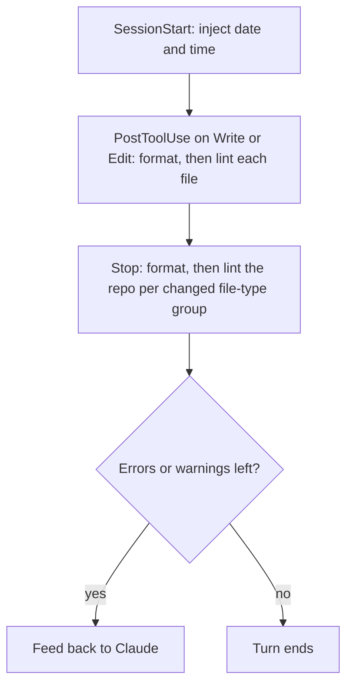

# CDK — Claude Dev Kit

Claude Code plugin providing a development kit — skills, custom agents, and hooks — for any framework or language.

Adds guided Git and GitHub workflows (signed atomic commits, rebases, issues, pull requests, reviews, releases) plus skill, README, and CLAUDE.md authoring with scored rubrics, so Claude follows the same conventions in every repository.

> **Status:** pre-1.0 (v0.9.6). This repo changes a lot: skills, agents, and hooks may be renamed or removed in any minor release, so pin a version. Breaking changes are listed in [CHANGELOG.md](CHANGELOG.md).

- [Compatibility](#compatibility)
- [Install](#install)
- [Components](#components)
- [Versioning and changelog](#versioning-and-changelog)
- [Development](#development)
- [Contributing](#contributing)
- [Support](#support)
- [License](#license)

## Compatibility

- [Claude Code](https://code.claude.com/docs) CLI (`claude`).
- Git; commit and rebase skills sign commits when signing is configured. `/cdk:setup-git` SSH signing needs Git 2.34+; OpenPGP needs GnuPG.
- [`glab`](https://gitlab.com/gitlab-org/cli) CLI, authenticated, optional: `/cdk:commit-changes` and `/cdk:rebase-onto` use it to look up GitLab protected branches and merge requests; the GitLab merge request skills and `/cdk:create-gitlab-issue` use it when the GitLab MCP server is not connected.
- [`gh`](https://cli.github.com/) CLI, authenticated, for the pull request skills, `/cdk:create-github-release`, and `/cdk:create-github-issue` when the GitHub MCP server is not connected.
- GitHub and GitLab MCP servers optional: skills call their tools first and fall back to `gh`/`glab` when a server is not connected or errors.
- [`uv`](https://docs.astral.sh/uv/) for `/cdk:setup-spec-kit` when `specify` is not installed.
- [`uv`](https://docs.astral.sh/uv/) or `pipx` (Python 3.10+) for `/cdk:setup-graphify` when `graphify` is not installed.
- Node.js with npm, pnpm, yarn, or bun for `/cdk:setup-husky`, `/cdk:setup-nextjs-app` (Node.js at least the version in Next.js `engines.node`), and the npm tools of `/cdk:setup-formatters` and `/cdk:setup-linters`; Node.js alone for `/cdk:update-statusline`. Node.js 22 or newer for `/cdk:audit-code-security`. Node.js 20.1 or newer for `/cdk:update-rules`.
- The project's package manager for `/cdk:upgrade-dependencies`.
- The .NET SDK (`dotnet`) and `curl` for `/cdk:setup-dotnet-api`; PHP and Composer for `/cdk:setup-laravel-api`.
- [`uv`](https://docs.astral.sh/uv/) (`uvx`) or `pipx` optional for `/cdk:update-dependabot` schema checks; without either it uses a manual checklist.
- Docker for `/cdk:build-dockerfile` build checks; `hadolint` optional.
- `/cdk:build-github-workflow` and `/cdk:build-github-action`: authenticated [`gh`](https://cli.github.com/) optional for action and release lookups; [`actionlint`](https://github.com/rhysd/actionlint) optional for validation; Docker optional for a Docker action's build check.
- `/cdk:build-gitlab-ci`: authenticated `glab` or a `GITLAB_TOKEN` optional for CI Lint validation; the token is sent only to the host in `GITLAB_HOST`, or to gitlab.com when `origin` is gitlab.com, so set `GITLAB_HOST` for a self-managed instance; falls back to `yamllint` or Python 3 with `yaml`.
- Docker for `/cdk:setup-devcontainer` Compose checks; [`@devcontainers/cli`](https://github.com/devcontainers/cli) optional for `devcontainer read-configuration`.
- Docker for `/cdk:setup-local-sonarqube` (the generated `compose.sonar.yaml` runs the SonarQube server and scanner as containers; no host install).
- Development only: Node.js >=22 with npm, `yamllint` and `yamlfmt` on `PATH`; `hadolint` optional (hook lints Dockerfiles when present).

## Install

```sh
claude plugin marketplace add https://github.com/patrickquijano/claude-dev-kit.git
claude plugin install cdk@claude-dev-kit
```

## Components

### Skills

A skill that reports findings (failed or skipped checks, gaps, open items) runs its own capped fix loop where it needs one and lists what is left under `Open:` before `Result:`. Every skill takes `--yes` (unattended: no questions, recommended options taken, assumptions listed under `Open:`). Where no safe default exists, `--yes` does nothing: `/cdk:delete-branches` selects no branch, `/cdk:rebase-onto` aborts at the first conflict and skips the push, and `/cdk:audit-code-security` takes `Report only` and fixes nothing. A skill may run another skill. Only `/cdk:switch-branch` switches or creates a branch and only `/cdk:commit-changes` commits; other skills run those two instead, except that `/cdk:rebase-onto` replays existing commits.

| Skill                                      | Purpose                                                                                                                                                                                                                                                                                                                                                                                                                                                                                                                                                                                            |
| ------------------------------------------ | -------------------------------------------------------------------------------------------------------------------------------------------------------------------------------------------------------------------------------------------------------------------------------------------------------------------------------------------------------------------------------------------------------------------------------------------------------------------------------------------------------------------------------------------------------------------------------------------------- |
| `/cdk:assess-spec-kit-idea`                | Assess an idea with Spec Kit intake to decide; on go, prints `Next: /cdk:run-spec-kit` with the brief. Never overwrites an existing assessment.                                                                                                                                                                                                                                                                                                                                                                                                                                                    |
| `/cdk:build-hook`                          | Create or update a Claude Code hook at plugin, project, or user scope from a described need, using the live hooks reference.                                                                                                                                                                                                                                                                                                                                                                                                                                                                       |
| `/cdk:build-subagent`                      | Interview (asks name, model, and effort with reasoned recommendations; color is derived from the tools), then create or update a subagent in personal, project, or plugin scope: write it through `/cdk:implement-spec`, check it with the bundled `check-agent` script (up to 3 fix rounds, each through `/cdk:implement-spec`), then audit it through `/cdk:audit-subagent`, extending by 3 more rounds or stopping at the 3-round cap.                                                                                                                                                          |
| `/cdk:build-docker-compose`                | Write a Docker Compose file for Compose / DevContainer (plain Compose) or Compose Deploy (Swarm stack): asks the target and app type (Backend API or Frontend UI), then the Dockerfile question, backing services for a backend, and per-service deploy settings for Compose Deploy; `compose.yaml` or `compose.<scope>.yaml`, exact-tag images from Docker Hub, researched practices, validated with `docker compose config` or `docker stack config` and linted with `dclint`; never starts containers, and suggests `/cdk:build-dockerfile` when a Dockerfile is missing.                       |
| `/cdk:build-dockerfile`                    | Write a multi-stage, tag-pinned Debian/Ubuntu/Alpine slim Dockerfile and `.dockerignore` from input and repo facts.                                                                                                                                                                                                                                                                                                                                                                                                                                                                                |
| `/cdk:build-github-workflow`               | Write or update GitHub Actions workflow files in `.github/workflows` (CI, release, deploy, scheduled, PR automation): exact-tag pins, least privilege, validated with the bundled `check-workflows` script.                                                                                                                                                                                                                                                                                                                                                                                        |
| `/cdk:build-github-action`                 | Create or update a custom GitHub Action (composite, JavaScript, or Docker) with `action.yml`, a test workflow, and a README, validated with the bundled `check-action` script.                                                                                                                                                                                                                                                                                                                                                                                                                     |
| `/cdk:build-gitlab-ci`                     | Create or update a GitLab CI/CD pipeline: a thin `.gitlab-ci.yml` plus one file per job in `.gitlab/ci`, exact image tags, validated with CI Lint.                                                                                                                                                                                                                                                                                                                                                                                                                                                 |
| `/cdk:update-rules`                        | Merge guidelines and engineering principles into CLAUDE.md and `.claude/rules`, each write through `/cdk:implement-spec`; score /100 until ≥95 (at the 3-round cap you extend by 3 more rounds or stop).                                                                                                                                                                                                                                                                                                                                                                                           |
| `/cdk:update-readme`                       | Create or update README.md from templates, each write through `/cdk:implement-spec`, score it /100, iterate until ≥95 (at the 3-round cap you extend by 3 more rounds or stop).                                                                                                                                                                                                                                                                                                                                                                                                                    |
| `/cdk:build-skill`                         | Create, update, or improve a skill, self-contained and Claude Code-only: gather scope and target path, stop when the input is not a skill fit, build from a bundled template under one rules file, write through `/cdk:implement-spec`, run the bundled `validate-skill` script (up to 3 fix rounds), then audit it through `/cdk:audit-skill` and write routing evals; at the 3-round cap you extend by 3 more rounds or stop. Built task skills take `--yes`.                                                                                                                                    |
| `/cdk:audit-skill`                         | Audit, score, and fix one or more skills against a 100-point rubric with gates, using parallel read-only scorers and fixes through `/cdk:implement-spec` for at most 2 rounds, ranking items by severity so only blocking ones loop; applies only verified fixes or ones you approve, with no extension past the cap. `--score-only` scores and reports without editing.                                                                                                                                                                                                                           |
| `/cdk:audit-subagent`                      | Audit, score, and fix one or more subagents against a 100-point rubric, fixing through `/cdk:implement-spec` for at most 2 rounds, ranking items by severity so only blocking ones loop, with no extension past the cap. `--score-only` scores and reports without editing.                                                                                                                                                                                                                                                                                                                        |
| `/cdk:audit-code-security`                 | Audit a whole repo for exploitable security flaws: map trust boundaries and sinks, hunt each unit in parallel waves by `--profile` (`quick`, `standard`, or `deep`), verify each candidate, then report confirmed findings and fix them through `/cdk:implement-spec` only when you answer `Fix now`. Scope with paths or `--range <a>..<b>` (`<b>` must resolve to `HEAD`); run files stay under `.cdk-security-audit/`.                                                                                                                                                                          |
| `/cdk:commit-changes`                      | Small changes: one signed commit, no subagent; large ones: atomic groups via analyzer; on a protected branch it runs `/cdk:switch-branch` first. Prints the plan, then commits. Never pushes.                                                                                                                                                                                                                                                                                                                                                                                                      |
| `/cdk:create-git-tag`                      | Create an annotated git tag at HEAD from the newest dated version in `CHANGELOG.md`; local only, never pushed.                                                                                                                                                                                                                                                                                                                                                                                                                                                                                     |
| `/cdk:push-commits`                        | Push the current branch's pending commits to its origin branch; stops with the reason when none are pending, on a protected branch, on a detached HEAD, or on an unsigned commit. No force.                                                                                                                                                                                                                                                                                                                                                                                                        |
| `/cdk:push-tags`                           | Push local git tags missing on the remote by explicit name, and report tags that differ between local and remote. No force.                                                                                                                                                                                                                                                                                                                                                                                                                                                                        |
| `/cdk:address-github-pull-request-review`  | Address unresolved review threads (outdated included), review-body items, and failing checks on a GitHub PR: triage by severity, fix every fixable item in one `/cdk:implement-spec` call (root cause and sibling occurrences, with tests, verified there), atomic signed commits through `/cdk:commit-changes`, one push, then reply on each thread (fixed with the short SHA, or invalid and needs-clarification items explained) plus one PR comment for review-body items; every item is tracked in a ledger. Never force-pushes or resolves threads; `--dry-run` prints the push and replies. |
| `/cdk:address-gitlab-merge-request-review` | Address open discussions, review-body items, and failing pipelines on a GitLab MR: triage by severity, fix every fixable item in one `/cdk:implement-spec` call (root cause and sibling occurrences, with tests, verified there), atomic signed commits through `/cdk:commit-changes`, one push, then reply on each discussion (fixed with the short SHA, or invalid and needs-clarification items explained) plus one MR comment for review-body items; every item is tracked in a ledger. Never force-pushes or resolves discussions.                                                            |
| `/cdk:create-github-release`               | Create a GitHub release with notes from the `CHANGELOG.md` section, or update one by tag, URL, or ID: weighted tag and draft-or-publish questions, the tag created and pushed from the verified tip of the default branch when missing. No force.                                                                                                                                                                                                                                                                                                                                                  |
| `/cdk:create-github-issue`                 | Create a GitHub issue from the repo's template, or update one by URL or number, filling every field from cited sources and setting only labels that exist; GitHub MCP first, `gh` fallback. Checks for open duplicates first.                                                                                                                                                                                                                                                                                                                                                                      |
| `/cdk:create-gitlab-issue`                 | Create a GitLab issue from the project's template, or update one by URL or IID, filling every field from cited sources and setting only labels that exist; quick-action lines become labels or are stripped. GitLab MCP first, `glab` fallback. Checks for open duplicates first.                                                                                                                                                                                                                                                                                                                  |
| `/cdk:delete-branches`                     | Delete local, remote, or both git branches chosen from paged lists; excludes the default, host-protected, current, and worktree branches. Never forces; prints the plan before deleting; `--yes` selects no branch.                                                                                                                                                                                                                                                                                                                                                                                |
| `/cdk:implement-spec`                      | Implement a spec end to end: plan through a read-only planner subagent, clarify goals, compare approaches, implement inline for at most 3 planned files (a `cdk:plan-implementer` subagent for more, one per group of files that share no file with another group), review and test through a verifier subagent (it runs the project's tests, type check, and build, never the format check or lint, which repo hooks and CI own), fix findings, and iterate up to 3 rounds. Works without git when the caller passes a target directory, and edits only inside a caller-passed write scope.       |
| `/cdk:fix-spec-kit-bug`                    | Extract bug evidence, run Spec Kit assess, fix, test; retry fix until verified (max 3).                                                                                                                                                                                                                                                                                                                                                                                                                                                                                                            |
| `/cdk:rebase-onto`                         | Fetch, pick a target branch, rebase with signed commits, resolve conflicts with you; pushes only with a pinned `--force-with-lease` when the upstream is `origin/<branch>`.                                                                                                                                                                                                                                                                                                                                                                                                                        |
| `/cdk:review-code-changes`                 | Review uncommitted and branch changes against optional intent text and the branch's commit messages, rate each finding by severity, fix `critical` and `major` ones through `/cdk:implement-spec` and re-review the delta (3 rounds, no extension), then fix `minor` ones once and commit through `/cdk:commit-changes`; never pushes.                                                                                                                                                                                                                                                             |
| `/cdk:review-github-pull-request`          | Review one GitHub PR alone: resolve your own addressed threads, run a file-coverage check and a completeness sweep, post severity-labeled threads (`critical`, `major`, and `minor` gate approval; `nit` and `question` do not), request changes while a gating thread is open, and approve when none is left. One review pinned to the head SHA.                                                                                                                                                                                                                                                  |
| `/cdk:review-gitlab-merge-request`         | Review one GitLab MR alone: resolve your own addressed threads, run a file-coverage check and a completeness sweep, post severity-labeled threads (`critical`, `major`, and `minor` gate approval; `nit` and `question` do not), request changes while a gating thread is open, and approve when none is left.                                                                                                                                                                                                                                                                                     |
| `/cdk:merge-github-pull-request`           | Merge one GitHub PR via the GitHub MCP server (`gh` fallback): ask the method (and branch cleanup unless the repo deletes merged branches itself) first, merge with the chosen method, verify the merge commit. Stops on a closed, draft, or conflicting PR and on a moved head; admin bypass only when your input asks for it and you own the PR.                                                                                                                                                                                                                                                 |
| `/cdk:merge-gitlab-merge-request`          | Merge one GitLab MR via the GitLab MCP server (`glab` fallback) with the chosen method and branch cleanup; a refused merge is reported with the host's exact error; never bypasses protection.                                                                                                                                                                                                                                                                                                                                                                                                     |
| `/cdk:interrogate-requirements`            | Question a rough requirement, task, or spec round by round (max 3 questions, 5 rounds) until every requirement is unambiguous, then output a spec with a decisions and assumptions log; every claim labeled Verified, User-stated, or Unverified.                                                                                                                                                                                                                                                                                                                                                  |
| `/cdk:open-github-pull-request`            | Create a GitHub PR from the diff, or update one by URL or number, with a Conventional Commits title and the repo's filled template; GitHub MCP first, `gh` fallback; `--draft`. Pushes the branch first when it is unpushed.                                                                                                                                                                                                                                                                                                                                                                       |
| `/cdk:open-gitlab-merge-request`           | Create a GitLab merge request from the diff, or update one by IID, URL, or branch, with a Conventional Commits title and the project's filled template; GitLab MCP first, `glab` fallback.                                                                                                                                                                                                                                                                                                                                                                                                         |
| `/cdk:draft-prompt`                        | Draft a brief Claude Code prompt from rough input (one-liner, brain-dump, bug report); drafts only and never runs it.                                                                                                                                                                                                                                                                                                                                                                                                                                                                              |
| `/cdk:run-spec-kit`                        | Split a feature brief, run Spec Kit from constitution to converge, address open items after. Never switches branches; reports a branch the Spec Kit git hook creates.                                                                                                                                                                                                                                                                                                                                                                                                                              |
| `/cdk:setup-local-sonarqube`               | Write `compose.sonar.yaml` with a pinned SonarQube Community Build and, for a supported stack, a Sonar Scanner service, plus `.vscode/tasks.json` tasks; it then configures the server (admin password, project, analysis token) into a gitignored `.env.sonar`; an unsupported stack gets a server-only file and a researched approach (prints the plan naming every effect first and never overwrites a file the plan does not name).                                                                                                                                                            |
| `/cdk:setup-devcontainer`                  | Detect stack and services, ask services and Claude Code, write a pinned image, Dockerfile, or Compose devcontainer with `/workspaces` mount and host extensions.                                                                                                                                                                                                                                                                                                                                                                                                                                   |
| `/cdk:setup-dotnet-api`                    | Set up a .NET Clean Architecture Web API with the latest stable SDK: EF Core, Scalar, ULID, Serilog, FluentValidation, tests, and JSON:API; an existing solution gets only what is missing, verified with `dotnet build -warnaserror`, `dotnet test`, and `dotnet format --verify-no-changes`. User-invoked only.                                                                                                                                                                                                                                                                                  |
| `/cdk:update-editorconfig`                 | Detect file types; create or update .editorconfig with a 4-space base, no final newline for Git, Markdown, and text files, and only non-redundant per-type overrides.                                                                                                                                                                                                                                                                                                                                                                                                                              |
| `/cdk:setup-formatters`                    | Set up one formatter per repo file type at a verified version, with its config and ignore paths.                                                                                                                                                                                                                                                                                                                                                                                                                                                                                                   |
| `/cdk:setup-linters`                       | Set up linters per repo file type at verified versions, with configs, ignores, and only the rule disables a present formatter's docs list.                                                                                                                                                                                                                                                                                                                                                                                                                                                         |
| `/cdk:setup-git`                           | Init repo; validate and repair identity and signing config, ask when unsure, test a signature; ignore lines for signing artifacts only.                                                                                                                                                                                                                                                                                                                                                                                                                                                            |
| `/cdk:setup-graphify`                      | Install graphify, add Claude and git hooks, build the graph, name communities, share graph and report, add ignores and rules.                                                                                                                                                                                                                                                                                                                                                                                                                                                                      |
| `/cdk:setup-husky`                         | Install Husky; add commit message (header ≤72) and signing checks, commit rules file; LF endings, ignores.                                                                                                                                                                                                                                                                                                                                                                                                                                                                                         |
| `/cdk:setup-laravel-api`                   | Set up a Laravel API at the latest stable versions: data stores, Scalar docs, Pint, Pest, Boost, IDE Helper, ULID migrations, and JSON:API; an existing Laravel app gets only what is missing, verified with Pint, Pest, and the API docs generator check. User-invoked only.                                                                                                                                                                                                                                                                                                                      |
| `/cdk:setup-nextjs-app`                    | Set up a Next.js app at the latest stable versions with Tailwind CSS, Vitest, Playwright, Orval, Zod, MSW, and Faker at 80% coverage; an existing `next` app skips the scaffold, verified with lint, typecheck, Vitest coverage, and Playwright. User-invoked only.                                                                                                                                                                                                                                                                                                                                |
| `/cdk:setup-spec-kit`                      | Install Spec Kit, init with Claude, add agent-context/assess/bug extensions, set ignores.                                                                                                                                                                                                                                                                                                                                                                                                                                                                                                          |
| `/cdk:switch-branch`                       | Derive a Conventional Branch name from the input (a full name or a description), or from unique commits and changes when none is given, switch to it, push.                                                                                                                                                                                                                                                                                                                                                                                                                                        |
| `/cdk:update-changelog`                    | Create or update CHANGELOG.md per Keep a Changelog from branch commits and working-tree changes; `release` cuts a dated version. Idempotent.                                                                                                                                                                                                                                                                                                                                                                                                                                                       |
| `/cdk:update-dependabot`                   | Create or update `.github/dependabot.yaml` from the repo's package ecosystems and directories, merged in place and schema-checked.                                                                                                                                                                                                                                                                                                                                                                                                                                                                 |
| `/cdk:update-gitignore`                    | Explore the repo for generated, local, and secret paths, report each with evidence, and append the ones you approve to .gitignore. Idempotent. Shows the exact lines first and asks before writing.                                                                                                                                                                                                                                                                                                                                                                                                |
| `/cdk:update-statusline`                   | Create or update the user-scoped Claude Code status line so the git branch name gets a distinct emphasized color; backs up first and never rewrites an existing `statusLine` command path. User-invoked only.                                                                                                                                                                                                                                                                                                                                                                                      |
| `/cdk:upgrade-dependencies`                | Find outdated packages, check breaking changes, apply fixes, and validate each upgrade.                                                                                                                                                                                                                                                                                                                                                                                                                                                                                                            |

### Agents

Spawned by skills; not meant for direct use, except `cdk:topic-researcher`.

| Agent                             | Purpose                                                                                                                                                                                                                                                                                  |
| --------------------------------- | ---------------------------------------------------------------------------------------------------------------------------------------------------------------------------------------------------------------------------------------------------------------------------------------- |
| `cdk:version-resolver`            | Resolve latest stable versions for one kind (`actions`, `dependencies`, `images`, `packages`) for `build-dockerfile`, `build-docker-compose`, `upgrade-dependencies`, `setup-formatters`, and `setup-linters`.                                                                           |
| `cdk:change-analyzer`             | Read changes and unique commits; draft atomic commit groups (`group`) or a branch name (`branch-name`) for `commit-changes` and `switch-branch`.                                                                                                                                         |
| `cdk:rubric-scorer`               | Score one kind (`skill-audit`, `subagent-audit`, `readme`, `project-instructions`) against its 100-point rubric for `audit-subagent`, `audit-skill`, `update-readme`, `update-rules`, giving each deduction an exact fix with its source.                                                |
| `cdk:code-reviewer`               | Review one area of a diff by `kind` (`intent`, `correctness`, `security`, `quality`, `sweep`, `threads`) for `review-code-changes`, `review-github-pull-request`, `review-gitlab-merge-request`, `address-github-pull-request-review`, `address-gitlab-merge-request-review`; read-only. |
| `cdk:security-reviewer`           | Map trust boundaries and sinks (`recon`), hunt one ledger unit (`hunt`), or verify one candidate finding (`verify`) for `audit-code-security`; read-only.                                                                                                                                |
| `cdk:conflict-analyzer`           | Analyze one conflicted file and propose a resolution for `rebase-onto`.                                                                                                                                                                                                                  |
| `cdk:repo-analyzer`               | Collect repo facts for one kind (`devcontainer`, `gitignore`, `permissions`, `readme`, `workflows`, `instructions`) for the matching setup, build, and update skills.                                                                                                                    |
| `cdk:practices-reviewer`          | Check a Dockerfile (`dockerfile`) or GitHub Actions workflows (`workflow`) against practices and available linters for `build-dockerfile`.                                                                                                                                               |
| `cdk:format-lint-analyzer`        | Detect file types, roles, candidates, and package manager (`detect`), or run checks (`check`) for `setup-formatters` and `setup-linters`.                                                                                                                                                |
| `cdk:plan-implementer`            | Apply a requirement's chosen approach to the planned files for `implement-spec`, `address-github-pull-request-review`, `address-gitlab-merge-request-review`.                                                                                                                            |
| `cdk:implementation-planner`      | Plan a multi-file change from repo evidence and docs (goals with checks, compared approaches, ordered steps, risks) for `implement-spec`, `address-github-pull-request-review`, `address-gitlab-merge-request-review`; read-only.                                                        |
| `cdk:change-verifier`             | Run the repo's documented checks in check mode (`checks`), judge the diff against goals (`goals`), check review feedback items against the final diff (`feedback`), for `implement-spec`.                                                                                                |
| `cdk:speckit-open-items-analyzer` | Find open Spec Kit items and propose fixes per round for `run-spec-kit`.                                                                                                                                                                                                                 |
| `cdk:topic-researcher`            | Research a topic across 3–6 sources and return cited, reconciled findings; delegate to it directly.                                                                                                                                                                                      |
| `cdk:codebase-explorer`           | Read-only lookups by `kind` (`locate`, `hypothesis`, `facts`, `leftovers`, `triage`); replaces `Explore`.                                                                                                                                                                                |

### Hooks

| Event                      | Script                            | Purpose                                                                                                                                                    |
| -------------------------- | --------------------------------- | ---------------------------------------------------------------------------------------------------------------------------------------------------------- |
| `PostToolUse` (Write/Edit) | `hooks/scripts/post-tool-use.mjs` | Format, then lint each file Claude edits with the repo's configured tools; failures go back to Claude as context, never blocking.                          |
| `Stop`                     | `hooks/scripts/stop.mjs`          | Format, then lint the whole repo with the same tools, per file type, only when that type's files changed; feeds errors and warnings back to Claude to fix. |
| `SessionStart`             | `hooks/scripts/session-start.mjs` | Inject today's date and time.                                                                                                                              |

### Hook flow

How the hooks fire across a session:



### Example

In a Claude Code session inside your repository:

```text
/cdk:update-readme score
```

Claude scores the existing `README.md` against the 100-point rubric and prints a per-criterion table with deductions. Score mode never writes files.

## Versioning and changelog

User-facing changes need a new `Unreleased` entry in `CHANGELOG.md`. The version level comes from the branch commits: breaking = major, `feat` = minor, otherwise patch. While the major version is 0, a breaking change bumps minor and everything else bumps patch; standard SemVer applies from 1.0.0. A version bump needs your confirmation and happens only for a PR or MR: edit the version in `.claude-plugin/plugin.json`, then run `/cdk:update-changelog`.

Releases: pushing a version tag (`vX.Y.Z`) runs [`.github/workflows/release.yml`](.github/workflows/release.yml), which publishes the GitHub release from that version's `CHANGELOG.md` section (a prerelease when the tag has a `-` suffix).

Breaking changes (mark the commit with `!`): renaming or removing a skill, slash command, or agent; changing a skill's arguments or required inputs, or an agent's `## Return` format callers parse; a hook that newly blocks, or a change to what it blocks; raising the minimum tool versions in Compatibility.

## Development

```sh
npm install                        # also installs Husky git hooks via prepare
npm run format
npm run lint                       # eslint, markdownlint-cli2, yamllint, yamlfmt, prettier
npm test                           # unit, then integration (node:test)
npm run test:unit
npm run test:integration
npm run audit
claude plugin validate --strict .
claude plugin eval .               # LLM-graded eval suite in evals/; manual only, not run by hooks
claude --plugin-dir .              # test local checkout
```

## Contributing

- Commits: signed, Conventional Commits subject only, ≤72 characters. Husky `commit-msg` runs commitlint; check a message with `npx commitlint --edit <file>`.
- Branches: `<type>/<short-description>`.
- Never bypass hooks with `--no-verify`.
- CI: pull requests to `main` run [`.github/workflows/lint.yml`](.github/workflows/lint.yml) (`npm run lint`, with `yamllint` 1.38.0 and `yamlfmt` v0.21.0).
- Open pull requests with the [default template](.github/pull_request_template.md).

## Support

Open an issue at <https://github.com/patrickquijano/claude-dev-kit/issues>.

## License

[MIT](LICENSE) © 2026 Patrick Quijano
