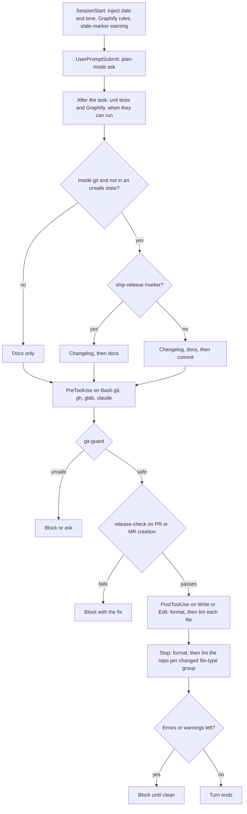

# cdk — Claude Dev Kit

Claude Code plugin providing a development kit — skills, custom agents, and hooks — for any framework or language.

Adds guided Git and GitLab workflows (signed atomic commits, rebases, merge requests, reviews) plus skill, README, and CLAUDE.md authoring with scored rubrics, so Claude follows the same conventions in every repository.

> **Status:** stable (v3.0.0). Follows Semantic Versioning; breaking changes come only in major versions and are listed in [CHANGELOG.md](CHANGELOG.md).

- [Compatibility](#compatibility)
- [Install](#install)
- [Components](#components)
- [Versioning and changelog](#versioning-and-changelog)
- [Configuration](#configuration)
- [Development](#development)
- [Contributing](#contributing)
- [License](#license)

## Compatibility

- [Claude Code](https://code.claude.com/docs) CLI (`claude`).
- Git; commit, rebase, and review-address skills sign commits when signing is configured. `/cdk:setup-git` SSH signing needs Git 2.34+; OpenPGP needs GnuPG.
- [`glab`](https://gitlab.com/gitlab-org/cli) CLI, authenticated, for `/cdk:ship-release` (GitLab) and the merge request skills.
- [`gh`](https://cli.github.com/) CLI, authenticated, for `/cdk:ship-release` (GitHub), the pull request skills, and `/cdk:create-github-release`.
- [`uv`](https://docs.astral.sh/uv/) for `/cdk:setup-spec-kit` when `specify` is not installed.
- [`uv`](https://docs.astral.sh/uv/) or `pipx` (Python 3.10+) for `/cdk:setup-graphify` when `graphify` is not installed.
- Node.js with npm, pnpm, yarn, or bun for `/cdk:setup-husky` and the npm tools of `/cdk:setup-format-lint`.
- The project's package manager for `/cdk:upgrade-dependencies`.
- The project's own test runners for the `/cdk:write-*-tests` skills; Docker for containerized integration dependencies.
- Docker for `/cdk:write-dockerfile` build checks; `hadolint` optional.
- `/cdk:write-github-workflows`: authenticated [`gh`](https://cli.github.com/) optional for release and pinning-policy lookups; [`actionlint`](https://github.com/rhysd/actionlint) and [`zizmor`](https://docs.zizmor.sh/) optional for validation.
- Docker for `/cdk:setup-devcontainer` Compose checks; [`@devcontainers/cli`](https://github.com/devcontainers/cli) optional for `devcontainer read-configuration`.
- Docker for `/cdk:scan-vulnerabilities` (every scanner runs as a container at its latest stable version, digest-locked per run) and Spec Kit (`/cdk:setup-spec-kit`) for its remediation.
- Development only: Node.js >=22 with npm, `yamllint` and `yamlfmt` on `PATH`; `hadolint` optional (hook lints Dockerfiles when present).

## Install

```sh
claude plugin marketplace add https://github.com/patrickquijano/claude-dev-kit.git
claude plugin install cdk@claude-dev-kit
```

## Components

### Skills

Every skill that reports findings (failed or skipped checks, gaps, suspected bugs, blockers, open items) ends with a **Resolve findings** step, after any own fix loop: it analyzes each open item (impact, fix, alternatives, validation), fixes safe in-scope ones and revalidates, and asks with a recommended option for the rest. Ask-only skills (review, posting, rebase, orchestrators, print-only) only report and ask. Unattended runs (chains, `--auto`, `--yes`, the end-of-task hook) ask nothing and report what is left. Only `switch-branch` has no step.

| Skill                                | Purpose                                                                                                                                                                                                                               |
| ------------------------------------ | ------------------------------------------------------------------------------------------------------------------------------------------------------------------------------------------------------------------------------------- |
| `/cdk:address-change-request-review` | Address review feedback on a GitHub PR or GitLab MR: classify, fix, validate, verify, then commit, push, reply, resolve, re-request review (asks first; `--yes` skips only the asks).                                                 |
| `/cdk:assess-spec-kit-idea`          | Assess an idea with Spec Kit intake to decide; go hands off to run-spec-kit unless `handoff=no`.                                                                                                                                      |
| `/cdk:build-agent`                   | Interview, then create or update a subagent in personal, project, or plugin scope.                                                                                                                                                    |
| `/cdk:build-skill`                   | Interview, then create or update a skill or orchestrator + subagents.                                                                                                                                                                 |
| `/cdk:bump-version`                  | Set the version in the files named by `.claude/release-policy.json` to the SemVer value the branch commits require, then runs `/cdk:write-changelog` when a changelog exists. Only for a PR or MR, and always asks first. Idempotent. |
| `/cdk:commit-changes`                | Small changes: one signed commit, no subagent; large ones: atomic groups via analyzer; leave protected branches, push.                                                                                                                |
| `/cdk:create-github-release`         | Tag and release the latest `CHANGELOG.md` version on GitHub from the verified tip of `main`: annotated tag, notes from the changelog section, no force, no edits to existing releases. Idempotent.                                    |
| `/cdk:debug-issue`                   | Find a bug's root cause, prove it with a failing regression test, and fix it after you confirm.                                                                                                                                       |
| `/cdk:fix-spec-kit-bug`              | Extract bug evidence, run Spec Kit assess, fix, test; retry fix until verified (max 3).                                                                                                                                               |
| `/cdk:prepare-change-request`        | Pick a target branch, review (five read-only agents, or direct for small changes), then create or update a GitHub PR or GitLab MR with a filled template, reviewers, and merge options.                                               |
| `/cdk:rebase-onto`                   | Fetch, pick a target branch, rebase with signed commits, resolve conflicts with you.                                                                                                                                                  |
| `/cdk:review-change-request`         | Review a GitHub PR or GitLab MR once (read-only agents, or direct for small changes), skip findings already discussed, post labeled comments after you approve, resolve addressed own threads, optionally approve and merge.          |
| `/cdk:review-local-changes`          | Review unpushed and uncommitted changes before a commit or PR exists; fix safe findings, ask about the rest.                                                                                                                          |
| `/cdk:run-spec-kit`                  | Split a feature brief, run Spec Kit from constitution to converge, address open items after.                                                                                                                                          |
| `/cdk:scan-vulnerabilities`          | Run Docker security scanners at their latest stable version, fix via run-spec-kit, validate, roll back, rescan (default 5 iterations).                                                                                                |
| `/cdk:setup-devcontainer`            | Detect stack and services, ask services and Claude Code, write a pinned image, Dockerfile, or Compose devcontainer.                                                                                                                   |
| `/cdk:setup-editorconfig`            | Detect file types; create .editorconfig with per-type indentation and line-ending defaults.                                                                                                                                           |
| `/cdk:setup-format-lint`             | Detect file types; pick, install latest verified stable versions, configure formatters and linters with defaults and ignores.                                                                                                         |
| `/cdk:setup-git`                     | Init repo; validate and repair identity and signing config, ask when unsure, test a signature; .gitignore.                                                                                                                            |
| `/cdk:setup-graphify`                | Install graphify, add Claude and git hooks, build the graph, name communities, share graph and report, add ignores and rules.                                                                                                         |
| `/cdk:setup-husky`                   | Install Husky; add commit message (header ≤72) and signing checks, commit rules file; LF endings, ignores.                                                                                                                            |
| `/cdk:setup-permissions`             | Inventory repo commands and the session's MCP tools; merge user-scoped allow, ask, deny rules (Bash pairs, exact MCP tool rules); validate, summarize.                                                                                |
| `/cdk:setup-project`                 | Detect missing setup, multi-select, then chain setup-git, -editorconfig, -format-lint, -husky, -testing.                                                                                                                              |
| `/cdk:setup-spec-kit`                | Install Spec Kit, init with Claude, add agent-context/assess/bug extensions, set ignores.                                                                                                                                             |
| `/cdk:setup-testing`                 | Detect stack and framework, recommend unit, integration, and e2e testers, install and configure missing ones in the native layout, add run scripts, note commands.                                                                    |
| `/cdk:ship-release`                  | Ship a GitHub PR or GitLab MR end to end: switch branch, atomic commits, version, changelog, README, create the PR or MR, review with labeled comments, address findings (3 rounds), merge, sync, summarize.                          |
| `/cdk:switch-branch`                 | Derive a Conventional Branch name from unique commits and changes, switch to it, push.                                                                                                                                                |
| `/cdk:upgrade-dependencies`          | Find outdated packages, check breaking changes, apply fixes, and validate each upgrade.                                                                                                                                               |
| `/cdk:write-changelog`               | Create or update CHANGELOG.md per Keep a Changelog from branch commits and working-tree changes; `release` cuts a dated version. Idempotent.                                                                                          |
| `/cdk:write-claude-md`               | Merge guidelines and engineering principles into CLAUDE.md and `.claude/rules`; score /100 until ≥95.                                                                                                                                 |
| `/cdk:write-dockerfile`              | Write a multi-stage, digest-pinned Debian/Ubuntu/Alpine slim Dockerfile and `.dockerignore` from input and repo facts.                                                                                                                |
| `/cdk:write-e2e-tests`               | Write AAA, faker-based end-to-end tests for critical journeys; run-fix until new tests pass (max 3).                                                                                                                                  |
| `/cdk:write-github-workflows`        | Write or update modular GitHub Actions workflows: deterministic names, one orchestrator calling a reusable workflow per job, POSIX sh, least privilege, versions resolved per run, plus a Dependabot `github-actions` entry.          |
| `/cdk:write-integration-tests`       | Write AAA, faker-based integration tests per boundary with containers, stubs, or fakes (max 3 fix rounds).                                                                                                                            |
| `/cdk:write-prompt`                  | Draft a brief Claude Code prompt from a rough task, checked against prompt anti-patterns.                                                                                                                                             |
| `/cdk:write-readme`                  | Create or update README.md from templates, score it /100, iterate until ≥95.                                                                                                                                                          |
| `/cdk:write-unit-tests`              | Write AAA, faker-based unit tests (≥2 positive, ≥2 negative each) until coverage target (default 90%, max 5). JS/TS ES modules: tests at `tests/unit/<mirrored path>`; relocates and upgrades existing ones.                          |

### Agents

Spawned by skills; not meant for direct use, except `cdk:topic-researcher`.

| Agent                             | Purpose                                                                                                                                                                       |
| --------------------------------- | ----------------------------------------------------------------------------------------------------------------------------------------------------------------------------- |
| `cdk:actions-version-resolver`    | Resolve latest stable action, runner, and image versions with SHAs or digests for `write-github-workflows`.                                                                   |
| `cdk:change-analyzer`             | Read changes and unique commits; draft atomic commit groups, a branch name, or an MR title and description for `commit-changes`, `switch-branch`, `prepare-change-request`.   |
| `cdk:claude-md-analyzer`          | Extract and flag memory-file instructions; collect commands, stack, and patterns for `write-claude-md`.                                                                       |
| `cdk:claude-md-scorer`            | Score CLAUDE.md and rules against the 100-point rubric for `write-claude-md`.                                                                                                 |
| `cdk:conflict-analyzer`           | Analyze one conflicted file and propose a resolution for `rebase-onto`.                                                                                                       |
| `cdk:dependency-analyzer`         | Find outdated packages, breaking changes, and affected code for `upgrade-dependencies`.                                                                                       |
| `cdk:devcontainer-analyzer`       | Detect stacks, versions, services, ports, and existing Docker files for `setup-devcontainer`.                                                                                 |
| `cdk:dockerfile-reviewer`         | Check a Dockerfile against practices, `docker build --check`, hadolint for `write-dockerfile`.                                                                                |
| `cdk:format-lint-analyzer`        | Detect file types, roles, candidates, and package manager, resolve latest stable versions, or run checks for `setup-format-lint`.                                             |
| `cdk:permission-analyzer`         | Inventory the commands a repo runs (tools, scripts, CI, destructive, privileged) for `setup-permissions`.                                                                     |
| `cdk:cr-feedback-collector`       | Rank open PRs by unresolved feedback or normalize raw review data for `address-change-request-review`.                                                                        |
| `cdk:cr-feedback-implementer`     | Apply one planned group of review fixes to the working tree for `address-change-request-review`.                                                                              |
| `cdk:cr-feedback-planner`         | Classify feedback items, group them, detect conflicts, and plan changes for `address-change-request-review`.                                                                  |
| `cdk:cr-feedback-replier`         | Draft per-item replies with commit and validation evidence for `address-change-request-review`.                                                                               |
| `cdk:cr-feedback-validator`       | Run the repo's documented checks in check mode for `address-change-request-review`.                                                                                           |
| `cdk:cr-feedback-verifier`        | Verify each feedback item against the final diff and validation for `address-change-request-review`.                                                                          |
| `cdk:cr-correctness-reviewer`     | Review the branch diff for bugs, regressions, and unintended changes for `prepare-change-request`, `review-change-request`, `review-local-changes`.                           |
| `cdk:cr-docs-reviewer`            | Review the branch diff for documentation, configuration, migration, and changelog needs for `prepare-change-request`.                                                         |
| `cdk:cr-maintainability-reviewer` | Review the branch diff for duplication, dead code, naming, layering, and convention drift for `prepare-change-request`, `review-change-request`, `review-local-changes`.      |
| `cdk:cr-security-reviewer`        | Review the branch diff for secrets, authorization, validation, injection, and dependency risks for `prepare-change-request`, `review-change-request`, `review-local-changes`. |
| `cdk:cr-test-reviewer`            | Review test coverage and run the documented checks for `prepare-change-request`, `review-change-request`, `review-local-changes`.                                             |
| `cdk:readme-analyzer`             | Collect repo facts and guess README archetype for `write-readme`.                                                                                                             |
| `cdk:readme-scorer`               | Score README against the 100-point rubric for `write-readme`.                                                                                                                 |
| `cdk:security-scanner`            | Run applicable Docker scanners, redact, dedupe, and prioritize findings for `scan-vulnerabilities`.                                                                           |
| `cdk:skill-auditor`               | Check skills and agents against repo rules and skill-agent contracts for `build-skill`, `build-agent`.                                                                        |
| `cdk:speckit-open-items`          | Find open Spec Kit items and propose fixes per round for `run-spec-kit`.                                                                                                      |
| `cdk:test-gap-analyzer`           | Detect stack, test tooling, conventions, and untested targets for the `write-*-tests` skills; report tester state for `setup-testing`.                                        |
| `cdk:topic-researcher`            | Research a topic across 3–6 sources and return cited, reconciled findings; delegate to it directly.                                                                           |
| `cdk:workflow-analyzer`           | Collect workflows, commands, services, naming, and pinning signals for `write-github-workflows`.                                                                              |
| `cdk:workflow-reviewer`           | Check workflows against practices, naming, contracts, POSIX sh, the gate job, actionlint, and zizmor for `write-github-workflows`.                                            |

### Hooks

| Event                      | Script                                 | Purpose                                                                                                                                                                                                                                                                                                                                                                                                                                                                                                                                                                                                                                                                                                                                                                                                                                                                                                                                                                                                                                                                                                                                                                                                         |
| -------------------------- | -------------------------------------- | --------------------------------------------------------------------------------------------------------------------------------------------------------------------------------------------------------------------------------------------------------------------------------------------------------------------------------------------------------------------------------------------------------------------------------------------------------------------------------------------------------------------------------------------------------------------------------------------------------------------------------------------------------------------------------------------------------------------------------------------------------------------------------------------------------------------------------------------------------------------------------------------------------------------------------------------------------------------------------------------------------------------------------------------------------------------------------------------------------------------------------------------------------------------------------------------------------------- |
| `PostToolUse` (Write/Edit) | `hooks/scripts/post-tool-use.mjs`      | Format, then lint each file Claude edits with the repo's configured tools.                                                                                                                                                                                                                                                                                                                                                                                                                                                                                                                                                                                                                                                                                                                                                                                                                                                                                                                                                                                                                                                                                                                                      |
| `Stop`                     | `hooks/scripts/stop.mjs`               | Format, then lint the whole repo with the same tools, per file type, only when that type's files changed; blocks Claude until errors and warnings are fixed.                                                                                                                                                                                                                                                                                                                                                                                                                                                                                                                                                                                                                                                                                                                                                                                                                                                                                                                                                                                                                                                    |
| `UserPromptSubmit`         | `hooks/scripts/user-prompt-submit.mjs` | One ordered dispatcher: plan-mode context first (ask the user via `AskUserQuestion` before `EnterPlanMode` on every prompt, with Claude weighing the recommended answer from its context, or `ExitPlanMode` for `#noplan` in plan mode; skips `/`, `!`, and background-agent or agent-message turns), then end-of-task steps: run the unit tests when a unit-test command is detected (`test:unit` or `test` script, pytest, go, cargo, or phpunit; fix and re-run until they pass), then refresh the Graphify graph when the `graphify` binary is installed (or suggest `/cdk:setup-graphify` when no graph exists), then add Unreleased changelog entries via `cdk:write-changelog` in a git repo when the task changed user-facing behavior, then update README and related docs when the task changed what they describe, then `cdk:commit-changes` (atomic commits, push); each step checks `git status --porcelain`; injected on every prompt, including questions and `/` and `!` prompts, and left out only when it cannot run: the changelog and commit steps need git and a safe state (no merge, rebase, or detached HEAD), and the commit step also needs no `/cdk:ship-release` run; never blocks. |
| `PreToolUse` (Bash)        | `hooks/scripts/pre-tool-use.mjs`       | Git-safety guard, then the release check. Blocks force pushes, `--no-verify`, `HUSKY=0` outside CI, deleting the default branch, `claude plugin eval`, and `gh pr merge --admin` during ship-release; asks before a bare `--force-with-lease`, a commit or push on the default branch, `reset --hard`, `clean -f`, and `branch -D`. Tag pushes pass.                                                                                                                                                                                                                                                                                                                                                                                                                                                                                                                                                                                                                                                                                                                                                                                                                                                            |
| `SessionStart`             | `hooks/scripts/session-start.mjs`      | Inject today's date and time, plus Graphify navigation rules when its graph files exist; warns about a stale ship-release marker on a fresh session.                                                                                                                                                                                                                                                                                                                                                                                                                                                                                                                                                                                                                                                                                                                                                                                                                                                                                                                                                                                                                                                            |

### Hook flow

How the hooks fire across a session:



### Example

In a Claude Code session inside your repository:

```text
/cdk:write-readme score
```

Claude scores the existing `README.md` against the 100-point rubric and prints a per-criterion table with deductions. Score mode never writes files.

## Versioning and changelog

A repo opts in with `.claude/release-policy.json` (changelog path, version files, `userFacing` globs, `exempt` entries with a reason). Without it nothing below runs. With it, a PR or MR cannot be created until `CHANGELOG.md` has a new `Unreleased` entry and every version file holds the version the branch commits require: breaking = major, `feat` = minor, otherwise patch, measured from the target branch tip. Three layers run the same script, `hooks/scripts/lib/release-check.mjs`:

1. `/cdk:prepare-change-request` runs a release gate first: on failure it chains `/cdk:bump-version` (after asking you to confirm the bump; it runs `/cdk:write-changelog` when a changelog exists), then `/cdk:write-changelog` for any changelog failure left, then `/cdk:commit-changes` (atomic commits and push), and revalidate.
2. The plugin `PreToolUse` hook (`hooks/scripts/pre-tool-use.mjs`, active in every repo) blocks `gh pr create`, `gh api` PR creation, `glab mr create`, `glab api` MR creation, and the GitLab MCP create call with the fix.
3. `.github/workflows/release-check.yml` runs the same check on every PR to `main`; make `release-check` a required status check, since local hooks can be bypassed.

GitLab has no CI job (GitLab CI was removed on purpose); GitLab MRs rely on the skill gate and the hook.

There is no per-PR override. The only exception is an `exempt` entry with a written reason in the policy, reviewed like any change.

## Configuration

No configuration.

## Development

```sh
npm install                        # also installs Husky git hooks via prepare
npm run format
npm run lint                       # eslint, markdownlint-cli2, yamllint, yamlfmt, prettier
npm test                           # unit, then integration (node:test)
npm run test:unit
npm run test:integration
npm audit --audit-level=moderate
claude plugin validate --strict .
claude plugin eval .               # LLM-graded eval suite in evals/; manual only, not run by hooks
claude --plugin-dir .              # test local checkout; /reload-plugins after edits
```

## Contributing

- Commits: signed, Conventional Commits subject only, ≤72 characters. Husky `commit-msg` runs commitlint; check a message with `npx commitlint --edit <file>`.
- Branches: `<type>/<short-description>`.
- Never bypass hooks with `--no-verify`.
- Open pull requests with the [default template](.github/pull_request_template.md).

## License

[MIT](LICENSE) © 2026 Patrick Quijano
